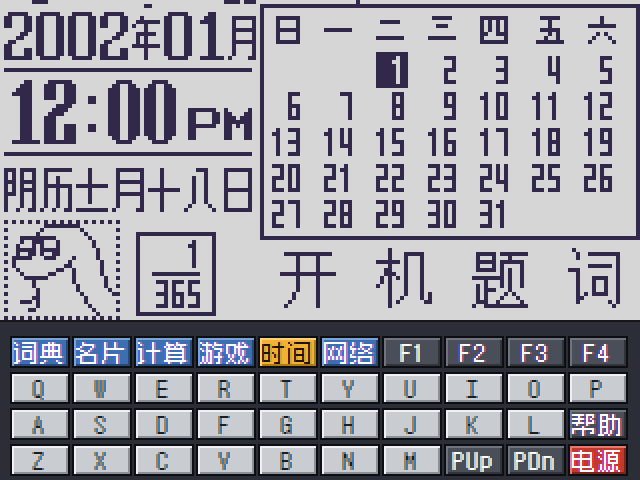

# WqxEmulator-GameShell
> 适配GameShell的文曲星NC1020模拟器

感谢 孤獨愛你 提供的png图标，使用了nw.js来运行，原项目地址：https://github.com/hackwaly/jswqx

## 预览

窗口按 GameShell 的 320×240 屏幕排布：上面是 320×160 的 LCD，下面是仿文曲星外壳的虚拟键盘（GameShell 没有键盘）。

## 操作

- **Select**：打开或收起虚拟键盘；**方向键** 选键，**A** 按下选中的键
- 键盘收起时：**A** 是回车，方向键就是文曲星的方向键
- **B**：AC（清除）　**Start**：大写锁定　**Menu**：退出

## 字体

虚拟键盘的按键文字用 [Zpix（最像素）](https://github.com/SolidZORO/zpix-pixel-font) 显示，在 320×240 下像素清晰。Zpix 的许可不允许二次分发，所以仓库里不附带：请从它的 [Releases](https://github.com/SolidZORO/zpix-pixel-font/releases) 下载 `zpix.ttf`，放到 `WqxEmulator/fonts/` 里（系统装了 Zpix 也可以）。没有的话会退回到 Arial。

## 如何游玩
把`WqxEmulator`文件夹放到GameShell的`\home\cpi\apps\Menu`中，刷新菜单后桌面就会出现Logo，打开即可。
当然，如果你的用户名修改过，不叫cpi，你可以在`WqxEmulator`文件夹中编辑`WqxEmulator.sh`的启动脚本，将`\home\cpi\apps\Menu`中的cpi改成你的用户名即可。

## 浏览器预览

从仓库根目录执行 `python3 -m http.server 8000 --bind 127.0.0.1`，然后打开
`http://127.0.0.1:8000/WqxEmulator/`，把浏览器窗口当作 320×240 的屏幕。空格键对应 Select，打开虚拟键盘；方向键选键，K 键对应 A。
