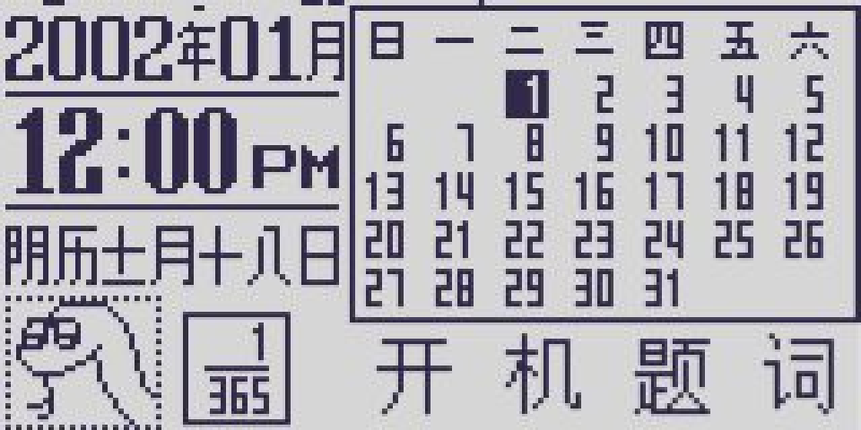

# WqxEmulator-GameShell
> 适配GameShell的文曲星NC1020模拟器

感谢 孤獨愛你 提供的png图标，使用了nw.js来运行，原项目地址：https://github.com/hackwaly/jswqx

## 预览

浏览器中的 NC1020 日历与时钟界面。

## 如何游玩
把`WqxEmulator`文件夹放到GameShell的`\home\cpi\apps\Menu`中，刷新菜单后桌面就会出现Logo，打开即可。
当然，如果你的用户名修改过，不叫cpi，你可以在`WqxEmulator`文件夹中编辑`WqxEmulator.sh`的启动脚本，将`\home\cpi\apps\Menu`中的cpi改成你的用户名即可。

## 浏览器预览

从仓库根目录执行 `python3 -m http.server 8000 --bind 127.0.0.1`，然后打开
`http://127.0.0.1:8000/WqxEmulator/`。完整 LCD 为 320×160 像素。
